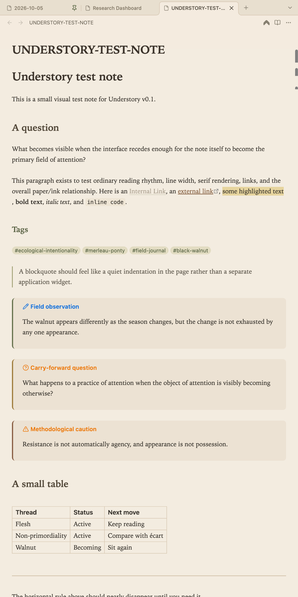
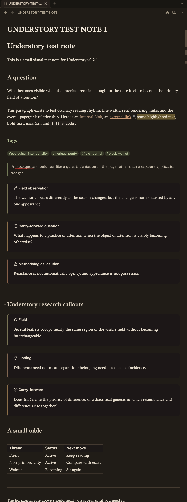

# Understory

[](https://doi.org/10.5281/zenodo.23176386)

**Understory** is a warm, quiet Obsidian theme for long-form reading, research, field notes, and writing.

Current **published** release: **v0.2.2**. **v0.2.3 is a review candidate**, not yet a GitHub release or an automatic Obsidian update.

It uses a parchment / walnut / moss visual language, with a light mode inspired by field notebooks and a dark mode built around walnut-shell browns rather than pure black.

## Design principles

- The note should remain the foreground.
- Interface chrome should recede.
- Color should differentiate, not decorate.
- Long-form reading should feel closer to a book than a dashboard.
- Research vocabulary can be supported visually without turning the vault into a taxonomy carnival.

## Screenshots

### Light mode



### Dark mode



## Features

- warm parchment light mode
- walnut-shell dark mode
- serif reading / writing typography
- restrained moss and autumn accents
- tuned long-form reading width and line height
- quiet sidebars, tabs, tags, tables, and graph defaults
- native research callouts:
  - `field`
  - `finding`
  - `carry-forward`

## Local installation

Copy the `Understory` folder into:

`.obsidian/themes/Understory/`

Then select **Understory** in Obsidian under:

Settings → Appearance → Themes

## Research callouts

```markdown
> [!field] Field observation
> What appeared before interpretation?

> [!finding] Finding
> A claim that has earned enough support to carry forward.

> [!carry-forward] Carry-forward question
> What should remain live in the next reading, sit, or writing session?
```

## Understory v0.2.3 candidate: The Next Episode

Three deliberately small refinements preserve the original theme's typography, sidebar, and parchment/walnut backgrounds.

### 1. A less dominant Properties panel (optional)

To move directly to prose, use Obsidian's native **Settings → Editor → Properties in document → Hidden**. Your YAML remains intact; you can inspect it through the Properties view.

If you prefer visible, editable metadata, install and enable [`understory-compact-properties.css`](snippets/understory-compact-properties.css) instead. This softens spacing and text weight without hiding fields. It does not automatically collapse or delete anything. The native Hidden option is global; the snippet changes only the presentation of visible metadata.

### 2. Four seasonal accents (optional)

Install **at most one** of these snippets at a time:

- [Spring leaf](snippets/understory-season-spring.css)
- [Summer canopy](snippets/understory-season-summer.css)
- [Autumn walnut gold](snippets/understory-season-autumn.css)
- [Winter branch](snippets/understory-season-winter.css)

They adjust the moss/accent family used by links, active tab and file indicators, field rules, and related controls, while keeping backgrounds and fonts unchanged. The default Understory appearance remains unchanged if none is enabled. Seasonal switching is manual, not driven by the calendar. These standalone snippets are **not packaged into the basic two-file theme installation**.

### 3. A quiet Field Journal signature (opt-in)

The v0.2.3 `theme.css` recognizes the built-in `cssclasses` property. Add the following to a field note (or merge `walnut-sit` into any existing `cssclasses` list):

```yaml
---
cssclasses:
  - walnut-sit
---
```

In Obsidian's Properties panel, you can also add the `cssclasses` property with a list value `walnut-sit`. This affects the displayed title, section headings, and Understory `[!field]` callouts **only in notes carrying that class**, in both Live Preview and Reading view as supported by Obsidian. The class name is an opt-in style convention, not a biological claim about the note or the tree. No folders or notes are automatically modified.

### Compatibility note: Obsidian 1.15 (November 2026)

The November 2 public **Obsidian 1.15 Desktop** update introduces the Pele Mermaid renderer, which inherits the active theme's colors and fonts and offers responsive zoomable diagrams. Understory 0.2.3 does **not** override Mermaid internals, so no chart-specific CSS adaptation is proposed without a real rendering failure.

The November 3 **1.15.1 Desktop Catalyst** changelog lists search, speed, Live Preview, and vault-sync changes; it does not announce a change to `cssclasses` or the CSS snippets API. The official Obsidian Help still documents `cssclasses` and the standard snippets workflow used here. This is a **source-level compatibility review**, not confirmation that the preview has rendered correctly on Obsidian 1.15.1.

**Device check:** In 1.15.1, a vault newly *shared with you* does not automatically sync appearance, themes or snippets on first connection. Check Obsidian Sync settings on each device rather than assuming a Mac theme edit will appear on iPhone/iPad. This is not described as a change to previously connected personal vaults.

Test especially: an existing long-Properties walnut note; Reading and Live Preview; the `walnut-sit` class; seasonal accent links and tags; the existing graph pane; light/dark; and an actual Mermaid diagram if you use one. On iPhone/iPad, check text sizing and the newly adjusted mobile sidebar layout. Do not raise the theme's `minAppVersion` merely because a newer Obsidian release is available.

### Preview installation before publishing v0.2.3

1. **Back up your existing local `Understory` theme folder** in the vault's `.obsidian/themes/` directory before replacing anything.
2. Download this branch's source from GitHub. When the review branch is merged, use **Code → Download ZIP** from the repository's `main` page; otherwise select the preview branch first.
3. From the downloaded repository, copy **only** `theme.css` and `manifest.json` into the existing `.obsidian/themes/Understory/` folder. Keep the directory name `Understory`. Obsidian may need **Reload app** after changing the manifest.
4. For optional accents and compact Properties, open **Settings → Appearance → CSS snippets → Open snippets folder**. Copy the desired files from this repository's `snippets/` folder there, click **Reload snippets**, and enable **one season at most** plus compact Properties if desired.
5. Add `walnut-sit` to one test field note's `cssclasses` list. Compare its Live Preview and Reading view, light and dark modes, then check your usual mobile setup. If anything feels wrong, turn off the snippets and restore the backed-up theme folder.

**Release step, only after testing:** Version `0.2.3` in `manifest.json` must match a future GitHub release tag `0.2.3`. If submitting through the Obsidian Community Themes directory, attach `manifest.json` and `theme.css` as files to that release. The optional snippets must still be installed separately. Do not use an old 0.2.2 version-specific software DOI as if it cited the new 0.2.3 build.

## Status

Understory is under active development and is being tested in a working research vault rather than designed only from mockups.

## License

MIT
